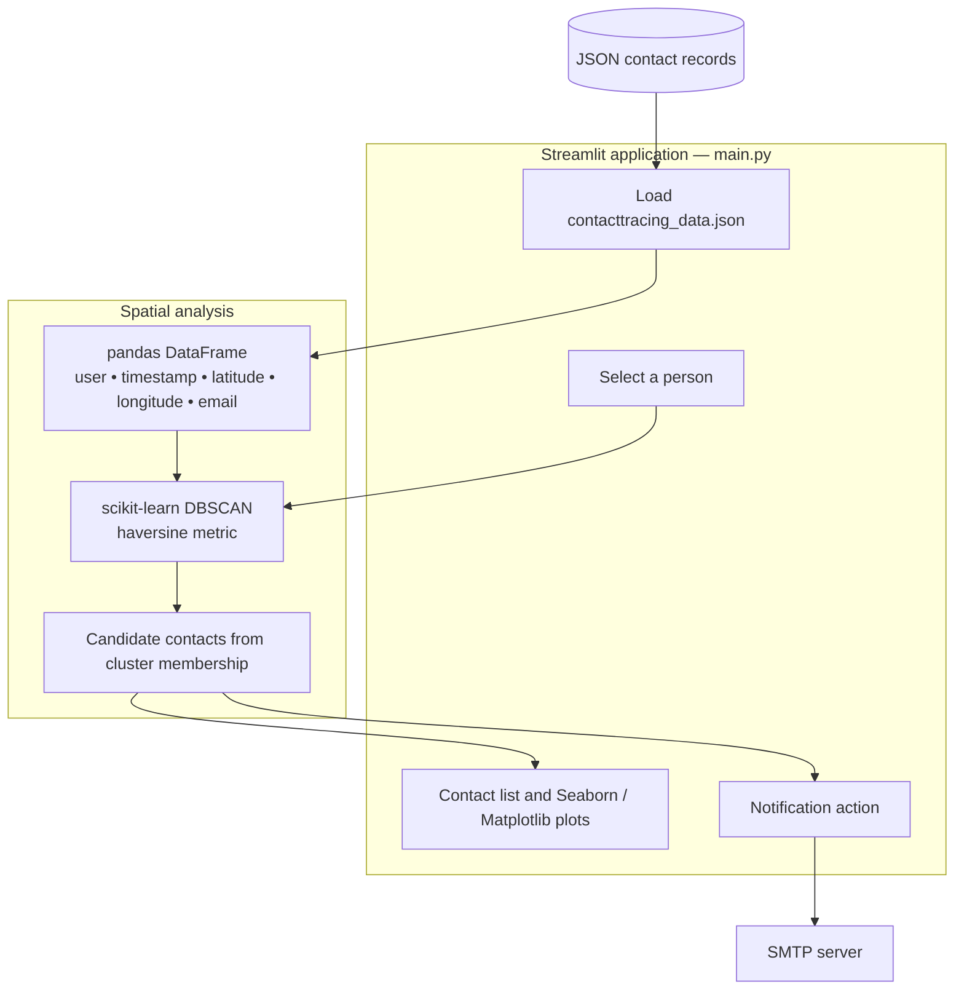

# TraceX

**Spatial clustering and contact-tracing exploration**

## Overview

TraceX is a Streamlit prototype for exploring proximity patterns in location records using DBSCAN clustering. It loads structured coordinates and user identifiers, groups nearby observations, identifies potential contacts for a selected individual, and displays spatial scatter plots. An optional SMTP integration can send notifications to matching contacts.

### Why it matters

Proximity data is difficult to interpret from rows of coordinates alone. TraceX turns those records into interactive contact and cluster views, demonstrating how a clustering algorithm can support investigation and communication workflows.

## Key capabilities

- Loads user, latitude, longitude, and email records from a local JSON-lines file.
- Provides a Streamlit input for selecting the person whose contacts should be explored.
- Uses DBSCAN to assign spatial clusters and identify other users in associated groups.
- Displays coordinate scatter plots of users and cluster assignments.
- Supports optional SMTP notifications for identified contacts.
- Keeps visual exploration and notification logic within a small Python application.

## System architecture



### How the workflow operates

The application reads `contacttracing_data.json` and uses the selected name to look up the relevant DBSCAN clusters. It extracts other users associated with those clusters and displays candidate contacts. Scatter plots show the underlying coordinate distribution and computed groups.

If the notification path is enabled, the script looks up corresponding email addresses and uses SMTP to send messages. Location access and messaging should be restricted to permission-cleared, synthetic demonstrations.

## Technology stack

| Technology | Purpose |
| --- | --- |
| **Python / pandas** | Load and filter location records |
| **Streamlit** | Interactive controls and outputs |
| **scikit-learn (DBSCAN)** | Spatial clustering |
| **Matplotlib / seaborn** | Coordinate scatter plots |
| **SMTP** | Optional email notifications |

## Repository structure

```text
main.py                  Streamlit UI and clustering logic
contacttracing_data.json Sample records used by the prototype
virus.jpg                Application background image
README.md                Project documentation
```

## Getting started

```bash
python3 -m venv .venv
source .venv/bin/activate
pip install streamlit pandas scikit-learn seaborn matplotlib
streamlit run main.py
```

## Notes and prerequisites

This is a learning prototype, not validated epidemiological contact tracing. The implementation currently applies a haversine distance metric to latitude/longitude inputs without converting coordinates to radians; results should not be interpreted as reliable physical exposure distances. SMTP credentials are placeholders in the code and should be loaded from configuration before enabling messaging.
